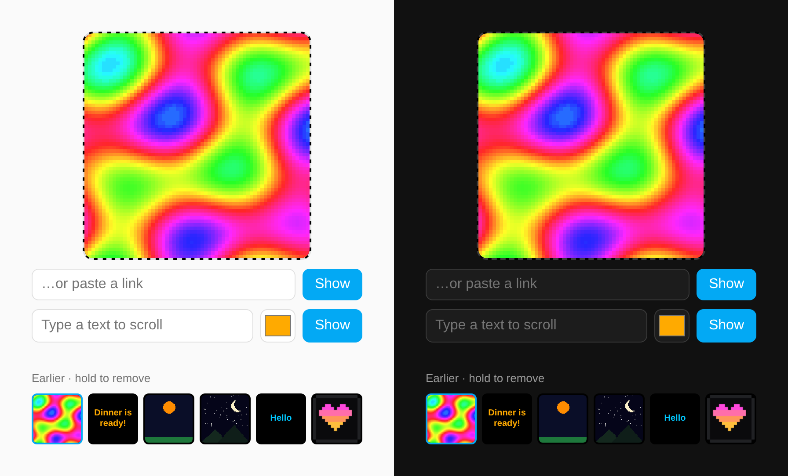

> [!WARNING]
> **This project is vibe coded.** It was written with an AI assistant and has been tested on one Pixoo 64 only. I take no responsibility for what it does to your display, your Home Assistant or anything else. Use it at your own risk.

# ESPHome Pixoo Gallery

Show pictures, GIFs and scrolling text on a Divoom Pixoo 64 flashed with ESPHome, from a Home Assistant dashboard card.



- Paste, drop or pick an image or GIF, paste a link, or type a text and pick its colour.
- Everyone in the house can use it from their phone. Uploads work for users who aren't admins.
- The last 40 things shown stay in a history list: tap one to show it again, hold it to remove it.
- Texts scroll on the display itself, smoothly and with no length limit beyond 120 characters.
- The display gets its picture back after a power cut.

It has two parts: an ESPHome package for the display, and a Home Assistant integration with a dashboard card built in.

## The display

The Pixoo 64 has to run ESPHome first. [docs/flashing.md](docs/flashing.md) explains how to back up the stock firmware and flash it without soldering.

Use this configuration in the ESPHome Device Builder. Keep your own `api`, `ota` and `wifi` blocks:

```yaml
esphome:
  name: pixoo64
  friendly_name: Pixoo 64

packages:
  pixoo: github://klejejs/ha-esphome-pixoo-gallery/esphome/pixoo64.yaml@main

logger:

api:
  encryption:
    key: !secret pixoo64_api_key

ota:
  - platform: esphome

wifi:
  ssid: !secret wifi_ssid
  password: !secret wifi_password
  ap:
    password: !secret wifi_password

captive_portal:
```

Replace `@main` with a release tag such as `@v0.1.0` to stay on a known version. The package adds a `show` and a `clear` action, the panel light, and diagnostic sensors for the frame timing.

## The integration

[](https://my.home-assistant.io/redirect/hacs_repository/?owner=klejejs&repository=ha-esphome-pixoo-gallery&category=integration)

1. Click the button above, or in HACS open the menu, choose **Custom repositories**, and add `https://github.com/klejejs/ha-esphome-pixoo-gallery` as an **Integration**.
2. Install **ESPHome Pixoo Gallery** and restart Home Assistant.
3. Add the integration with the button below, or under **Settings → Devices & services → Add integration → ESPHome Pixoo Gallery**. Pick the Pixoo, and check the address the display will use to download pictures from Home Assistant.

[](https://my.home-assistant.io/redirect/config_flow_start/?domain=esphome_pixoo_gallery)

The address has to be reachable from the display on your network, for example `http://192.168.1.10:8123`. Plain `http` is the safe choice, because the display may not accept your certificate.

## The card

The integration loads the card itself, so there is no resource to add. In a dashboard, add the card **ESPHome Pixoo Gallery**, or in YAML:

```yaml
type: custom:esphome-pixoo-gallery-card
```

With more than one display, add `entry_id:` with the integration entry's ID.

## Actions

| Action | Does |
| --- | --- |
| `esphome_pixoo_gallery.show` | Shows a `url`, a `media` item or a `text` with a `color` |
| `esphome_pixoo_gallery.forget` | Removes one entry from the history, by its `key` |
| `esphome_pixoo_gallery.clear` | Stops showing the picture |

For example, in an automation:

```yaml
action: esphome_pixoo_gallery.show
data:
  text: Dinner is ready!
  color: [255, 170, 0]
```

The integration also adds an image entity with what the display shows now. To turn the display off at night or when nobody is home, turn its light off in an automation of your own. The picture comes back when the light comes on.

## How it works

The integration converts every picture into a PNG strip the display downloads in one go. Frames are scaled to 64×64 and stacked vertically, at most 100 per GIF. The frame delay rides along as extra columns, one per 10 ms. A text becomes one wide band that the display scrolls itself, with the speed carried in the band's height. Because of this, the display knows how to play a picture from the file alone.

The display downloads the strip without logging in, from an address with a random token in it. Thumbnails, history and uploads need a Home Assistant login. Uploads go to `/media/esphome_pixoo_gallery/`.

## Licence

MIT. The bundled DejaVu Sans Bold font has its own licence in [`fonts/LICENSE`](custom_components/esphome_pixoo_gallery/fonts/LICENSE).
